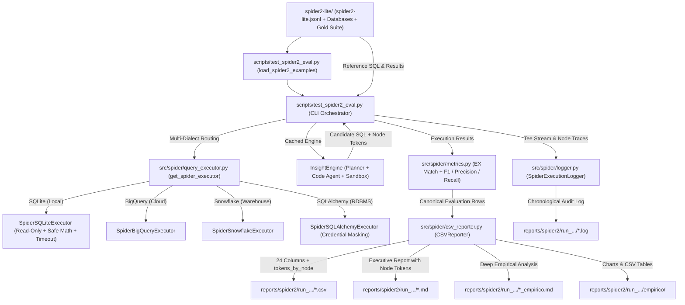

# Spider 2.0 Benchmark Evaluation Manual - TextToInsight

This technical manual establishes the operational guide for reproducing, configuring, running, and auditing the **Spider 2.0 (Spider 2.0 Lite)** benchmark within the TextToInsight repository.

---

## 1. Pipeline Architecture

The Spider 2.0 evaluation suite is composed of decoupled, single-responsibility modules responsible for dataset ingestion, dialect routing, safe multi-DBMS query execution, column-level metric computation, node-level token accounting, and multi-format report generation:



---

## 2. Environment & Spider 2.0 Lite Dataset Setup

### 2.1. Virtual Environment Activation
Ensure that the project's virtual environment is activated before running evaluation scripts:
```bash
source .venv/bin/activate
```

### 2.2. Spider 2.0 Lite Directory Structure
The Spider 2.0 Lite benchmark dataset is stored under the `spider2-lite/` directory with the following layout:
```text
spider2-lite/
├── spider2-lite.jsonl                          # Instance manifest (JSON Lines)
├── resource/
│   ├── databases/
│   │   └── spider2-localdb/                   # SQLite database files (.sqlite / .db)
│   │       ├── E_commerce/
│   │       ├── Financial/
│   │       └── ...
│   └── documents/                             # External business knowledge documents (.md)
│       ├── doc_001.md
│       └── ...
└── evaluation_suite/
    └── gold/
        ├── sql/                               # Official reference SQL queries (.sql)
        │   ├── local_001.sql
        │   └── ...
        └── exec_result/                       # Pre-executed reference CSV result sets
            ├── local_001.csv
            └── ...
```

### 2.3. Credentials & Environment Variables
Configure your model provider keys and cloud warehouse credentials in `.env`:
```bash
# Model Provider Keys
OPENAI_API_KEY="sk-..."
GOOGLE_API_KEY="AIza..."

# Optional Cloud Database Credentials
BIGQUERY_PROJECT_ID="your-gcp-project"
SNOWFLAKE_ACCOUNT="your-account"
SNOWFLAKE_USER="your-user"
SNOWFLAKE_PASSWORD="your-password"
```

---

## 3. Automated Sanity Tests

Before launching live model evaluation runs, verify system integrity using the automated test suite.

### 3.1. Fast Isolated Unit Tests
Execute the comprehensive Spider 2.0 test suite via `pytest`:
```bash
pytest tests/test_spider2_eval.py -v
```
Characteristics of this test suite:
- **Zero API Dependencies:** Requires no active network connection, OpenAI, or Google API credits.
- **Dynamic Isolation:** Uses the synthetic fixture `mock_spider2_env(tmp_path)` to generate mock databases, schemas, queries, and documents on the fly.
- **Zero Dependency on `spider2-lite/`:** Fully independent of unversioned dataset downloads, guaranteeing deterministic runs in CI/CD pipelines.
- **Broad Coverage:** Tests manifest loading, prefix dialect routing (`local_`, `bq_`, `sf_`), mutation blocking (`DROP`, `INSERT`, `UPDATE`, `DELETE`, `ALTER`), safe math wrappers (`SQRT`, `LOG`, `POW`), secret leak prevention, logger Tee stream capture, and CSV reporting.

### 3.2. Zero-Cost Dry-Run Smoke Test
Test the entire evaluation pipeline end-to-end without consuming API tokens:
```bash
python scripts/test_spider2_eval.py --dry-run --sample-size 2
```
In `--dry-run` mode:
- LLM invocations are simulated with realistic outputs and full `tokens_by_node` distributions across all 7 canonical nodes.
- Local SQLite database queries are executed safely in read-only mode.
- Exact match (`EX`) and column-level metrics (`F1`, `Recall`, `Precision`) are computed against gold results.
- All five output artifacts (`.csv`, `.md`, `.log`, `_empirico.md`, `empirico/`) are written to `reports/spider2/run_<timestamp>/`.

---

## 4. Execution Guide & CLI Parameter Catalog

The Spider 2.0 evaluation orchestrator is invoked via `scripts/test_spider2_eval.py`.

### 4.1. Complete CLI Parameter Catalog

| Parameter | Type / Values | Default | Description |
|---|---|---|---|
| `--model` | String | Env or `gpt-4o-mini` | LLM model identifier. Supports `<provider>/<model>` format (e.g. `openai/gpt-4o-mini`, `google/gemini-2.5-flash`). |
| `--api-key-env` | String (`^[A-Z_][A-Z0-9_]*$`) | Provider default | Name of the environment variable storing the API key (e.g. `OPENAI_API_KEY`). **Blocks raw keys** (`sk-`, `AIza`) without leaking secret values. |
| `--model-kwargs` | `KEY=VALUE ...` | `[]` | Extra kwargs passed to the LLM constructor. **Blocks sensitive keys** (`api_key`, `token`, `secret`, `password`) and redacts them in reports. |
| `--temperature` | Float `>= 0` | Provider default | Shortcut merged into `model_kwargs["temperature"]`. |
| `--max-tokens` | Integer `> 0` | Provider default | Shortcut merged into `model_kwargs["max_tokens"]`. |
| `--rag` | `on`, `off` | `on` | Enables SchemaGraphRAG for dynamic table and schema retrieval. |
| `--enrich-rag` | `on`, `off` | `off` | Enables semantic column-level description enrichment in RAG. |
| `--cot` | `on`, `off` | `on` | Enables Chain-of-Thought explicit reasoning in Code Agent. |
| `--data-exploration` | `on`, `off` | `on` | Enables active exploratory SQL sampling against tables. |
| `--exploration-selector` | `off`, `llm`, `rag` | `off` | Column selection mode for data exploration. |
| `--infer-fks` | `on`, `off` | `off` | Enables virtual foreign key inference heuristic. |
| `--with-graphs` | `on`, `off` | `off` | Enables chart generation (matplotlib) and CSV data exports. |
| `--use-evidence` | `on`, `off` | `on` | Injects external knowledge documents and hints into prompt context. |
| `--timeout` | Integer | `30` | Execution timeout in seconds for SQL queries. |
| `--dry-run` | Flag | Disabled | Simulates LLM execution at zero cost while testing full pipeline. |
| `--log` | `on`, `off` | `on` | Controls generation of detailed `.log` execution trace. |
| `--log-file` | Path | `None` (auto) | Custom destination path for the execution log file. |
| `--output` | Path | `None` (auto) | Custom output CSV file path or run directory. |
| `--sample-size` | Integer | `None` (all) | Number of instances to evaluate. |
| `--seed` | Integer | `42` | Random seed for reproducible sampling. |
| `--db-filter` | String | `None` | Filters evaluation to a specific database ID (e.g. `E_commerce`). |
| `--question-filter` | String | `None` | Filters evaluation by substring in question text. |
| `--dialect` | `sqlite`, `bigquery`, `snowflake`, `all` | `sqlite` | Filters instances by target database dialect. |
| `--data-dir` | Path | `spider2-lite` | Root directory containing the Spider 2.0 dataset. |
| `--sqlite-dir` | Path | `spider2-lite/resource/databases/spider2-localdb` | Root directory containing local SQLite database files. |
| `--max-attempts` | Integer | `3` | Maximum self-correction loop attempts per instance. |

---

### 4.2. Common Execution Scenarios

#### Quick Reproducible Test on SQLite
Evaluate 5 randomly sampled SQLite questions with seed 42:
```bash
python scripts/test_spider2_eval.py --sample-size 5 --seed 42 --dialect sqlite
```

#### Evaluation on a Specific Database
Filter by database ID to debug a specific domain (e.g. `Financial`):
```bash
python scripts/test_spider2_eval.py --db-filter Financial --sample-size 10
```

#### Component Ablation Study (RAG & Evidence Impact)
Evaluate system performance with and without schema retrieval and external evidence:
```bash
# Baseline: Full system (RAG + Evidence)
python scripts/test_spider2_eval.py --sample-size 20 --seed 42 --rag on --use-evidence on --output reports/spider2/baseline

# Ablation: Without Evidence
python scripts/test_spider2_eval.py --sample-size 20 --seed 42 --rag on --use-evidence off --output reports/spider2/no_evidence

# Ablation: Without RAG
python scripts/test_spider2_eval.py --sample-size 20 --seed 42 --rag off --use-evidence on --output reports/spider2/no_rag
```

#### Multi-Dialect Evaluation
Evaluate across all dialects or specifically on BigQuery / Snowflake instances:
```bash
# Evaluate only BigQuery instances
python scripts/test_spider2_eval.py --dialect bigquery --sample-size 10

# Evaluate only Snowflake instances
python scripts/test_spider2_eval.py --dialect snowflake --sample-size 10
```

---

## 5. Artifact Management in `reports/spider2/run_<timestamp>/`

Each evaluation run produces five complementary artifacts organized cleanly inside a dedicated run directory:

```text
reports/spider2/run_2026-11-03_14-30-00/
├── spider2_eval_2026-11-03_14-30-00.csv          # 24-column detailed CSV with tokens_by_node
├── spider2_eval_2026-11-03_14-30-00.md           # Executive report with Node-Level Token table
├── spider2_eval_2026-11-03_14-30-00.log          # Complete chronological Tee audit trace
├── spider2_eval_2026-11-03_14-30-00_empirico.md  # Deep empirical analysis report
└── empirico/                                     # Empirical charts (PNG) and data tables (CSV)
    ├── chart_latency_vs_tokens.png
    ├── chart_accuracy_by_attempts.png
    └── table_distribution_metrics.csv
```

### 5.1. The Five Generated Artifacts

1. **Detailed Evaluation CSV (`.csv`):**
   Records every attempt for every question. When self-correction is activated, each retry is saved as an individual contiguous row (`tentativa_numero` = 1, 2, 3...). Contains 24 columns covering candidate SQL, gold SQL, execution errors, column F1/Precision/Recall, similarity, latency, tokens, and `tokens_by_node` JSON.
2. **Executive Markdown Report (`.md`):**
   Summarizes global execution accuracy (`EX Final`), Pass@1 accuracy, column metrics, sanitized configuration parameters, and:
   - **Section 4.1 (Node-Level Token Consumption):** Breakdown table detailing `Calls`, `Total Input`, `Total Output`, `Total All`, `Avg/Q Total`, and `% Total` across all 7 canonical nodes.
   - **Section 5 (Successful Self-Correction Cases):** Instances that failed attempt 1 but recovered in subsequent attempts.
   - **Section 6 (Detailed Failure Diagnosis):** Comparative inspection tables displaying candidate vs. gold queries and row-level diffs.
3. **Structured Audit Log (`.log`):**
   Created by `SpiderExecutionLogger` (`src/spider/logger.py`), providing an exhaustive trace:
   - Delimited blocks: `=== [START INSTANCE: ... | DB: ... | Dialect: ...] ===` and `=== [END INSTANCE: ...] ===`.
   - Live console output captured via Tee stream without blocking terminal rendering.
   - Full prompts, model thoughts (`<thought>`), candidate SQL, sandbox errors, and evaluation comparisons.
   - Per-instance `--- [TOKENS BY NODE] ---` breakdown table.
   - `NODE-LEVEL TOKEN CONSUMPTION SUMMARY` in the run footer.
4. **Empirical Analysis Report (`_empirico.md`):**
   Examines correlation between attempts, latency, token consumption, and accuracy. Calculates statistical distribution percentiles (Mean, Median, P75, P90, P95).
5. **Empirical Visualizations Folder (`empirico/`):**
   Stores high-resolution charts and exported tabular data for academic papers and presentation decks.

### 5.2. Customizing Output Paths via `--output`

- **Directory Destination (Recommended):**
  ```bash
  python scripts/test_spider2_eval.py --sample-size 10 --output reports/spider2/experiment_cot
  ```
  Generates all 5 artifacts inside `reports/spider2/experiment_cot/`.
- **Explicit CSV File Destination:**
  ```bash
  python scripts/test_spider2_eval.py --sample-size 10 --output reports/spider2/eval_run.csv
  ```
  Uses `eval_run` as the base name to generate `eval_run.csv`, `eval_run.md`, `eval_run.log`, `eval_run_empirico.md`, and `empirico/`.
- **Default Timestamped Structure (When `--output` is omitted):**
  Automatically creates `reports/spider2/run_YYYY-MM-DD_HH-MM-SS/`.

---

## 6. Metrics Dictionary & Node-Level Token Tracking

Metrics are computed by `src/spider/metrics.py` and aggregated by `src/spider/csv_reporter.py`.

### 6.1. Accuracy & Performance Metrics

| Metric | Identifier | Scope & Calculation |
|---|---|---|
| **Execution Accuracy (EX Final)** | `taxa_aprovacao` / `ex_final_rate` | Primary benchmark metric. Executes candidate and reference queries against the database; compares multiset of result rows (`Counter`) with float tolerance (`1e-2`). Evaluates to `True` (100%) or `False` (0%). |
| **Pass@1 EX Accuracy** | `taxa_1a_tentativa` / `ex_pass_at_1_rate` | Percentage of instances solved correctly on the first attempt without activating self-correction loops. |
| **Column-Level Recall** | `avg_recall` | Proportion of reference columns successfully retrieved by the candidate query. |
| **Column-Level Precision** | `avg_precision` | Proportion of candidate query columns that match expected reference columns. |
| **Column-Level F1 Score** | `avg_f1` | Harmonic mean of column Precision and Recall: `2 * (P * R) / (P + R)`. |
| **Self-Correction Recovery Rate** | `self_correction_rate` | Percentage of instances that failed on attempt 1 but succeeded on attempt 2 or 3. |
| **SQL Syntactic Similarity** | `similarity_media` | Text similarity calculated via `difflib.SequenceMatcher` after standardizing keywords, comments, and whitespace. |
| **Query Latency** | `tempo_medio_ms` | Total elapsed execution time in milliseconds per instance. |

---

### 6.2. Node-Level Token Tracking (`tokens_by_node`)

To enable granular cost accounting and architectural bottleneck identification, token consumption is tracked across the **7 canonical LLM nodes**:

| Canonical Node | Role in Pipeline | When Active |
|---|---|---|
| `planner` | High-level execution planning & query decomposition | Initial task planning |
| `rag_enrichment` | Semantic column-level description and metadata enrichment | Schema retrieval phase |
| `exploration_selector` | Selecting sample columns for active data exploration | Data exploration phase |
| `code_agent` | Code generation, self-correction reasoning, and SQL authoring | Main code generation loop |
| `graph_router` | Routing decisions between relational queries and graph generation | Graph routing phase |
| `graph_generator` | Generating Python/matplotlib scripts for visualizations | Chart generation phase |
| `response` | Synthesizing final conversational user explanations | Final response phase |

Each node records:
- `calls`: Total LLM invocations triggered by this node.
- `input`: Total prompt/context tokens consumed.
- `output`: Total completion/generation tokens produced.
- `total`: Combined input and output tokens.

---

## 7. Failure Diagnosis & Audit Guide

### 7.1. Structure of the 24 CSV Columns

| Column | Description |
|---|---|
| `id_exemplo` | Benchmark instance identifier (e.g. `local_001`, `bq_010`, `sf_002`). |
| `tentativa_numero` | Attempt index (1, 2, 3...). Values > 1 indicate self-correction activation. |
| `db_id` | Database identifier. |
| `pergunta_usuario` | Natural language question text. |
| `query_ouro_spider` | Official reference SQL query from the evaluation suite. |
| `query_agente_tentativa` | Candidate SQL query generated by the agent on this attempt. |
| `tempo_agente_ms` | Attempt latency in milliseconds. |
| `veredito_critico` | Agent self-critic verdict (`aprovado`, `reprovado`, `erro`). |
| `feedback_critico_recebido` | Error feedback message forwarded to the next attempt. |
| `erro_execucao` | Database engine error message (if execution failed). |
| `resultado_exato_match` | Boolean exact match (`True`/`False`) against reference results. |
| `similarity_score_sql` | Textual SQL similarity score (0.0 to 1.0). |
| `resultado_f1` | Column-level F1 score (0.0 to 1.0). |
| `resultado_precision` | Column-level Precision score (0.0 to 1.0). |
| `resultado_recall` | Column-level Recall score (0.0 to 1.0). |
| `tokens_input` | Input tokens consumed on this attempt. |
| `tokens_output` | Output tokens produced on this attempt. |
| `tokens_total` | Total tokens consumed on this attempt. |
| `viz_acionado` | Boolean indicating if data visualization was triggered. |
| `viz_sucesso` | Boolean indicating if data visualization succeeded. |
| `resultado_exato_match_1a_tentativa` | Exact match status specifically on attempt 1. |
| `resultado_f1_1a_tentativa` | Column F1 score specifically on attempt 1. |
| `query_1a_tentativa` | SQL query generated on attempt 1. |
| `tokens_by_node` | JSON-serialized dictionary mapping canonical nodes to `NodeTokenUsage`. |

### 7.2. Diagnostic Workflow

1. **Macro Assessment via `.md` Report:**
   Check global `Execution Accuracy (Final EX)` and `Pass@1 EX`. Inspect the `Node-Level Token Consumption` table to verify which nodes accounted for the highest resource consumption.
2. **Filtering Failed Instances via `.csv`:**
   Filter rows where `resultado_exato_match == False` on the final attempt. Examine `erro_execucao` for recurring syntax errors or missing table exceptions.
3. **Deep Audit via `.log` File:**
   Locate the instance block: `=== [START INSTANCE: <id> | DB: <db> | Dialect: <dialect>] ===`.
   - Inspect `[FULL PROMPT SENT TO LLM]` to verify if schema context or external knowledge was truncated.
   - Inspect `[AGENT REASONING (CoT / THOUGHT)]` to understand why the agent chose specific JOINs, aggregations, or filters.
   - Review `--- [TOKENS BY NODE] ---` to check token efficiency per attempt.

---

## 8. Official Spider 2.0 Harness Validation

The outputs produced by `scripts/test_spider2_eval.py` are fully compatible with official Spider 2.0 evaluation conventions.

Reference results in `spider2-lite/evaluation_suite/gold/exec_result/` are compared directly using multiset tuple equivalence. For external validation against official benchmark repositories, candidate queries from `spider2_eval_*.csv` can be exported directly to the official JSON prediction format.

---

## 9. Multi-Dialect & Multi-DBMS Support

Spider 2.0 encompasses diverse DBMS targets across local databases and cloud data warehouses.

### 9.1. Supported Database Engines
- **SQLite (`SpiderSQLiteExecutor`):** Default engine for local databases (`resource/databases/spider2-localdb/`). Enforces read-only connection strings (`?mode=ro&uri=true`), blocks mutation keywords (`DROP`, `ALTER`, `INSERT`), and injects safe math functions (`SQRT`, `LOG`, `POWER`, `EXP`).
- **BigQuery (`SpiderBigQueryExecutor`):** Adapter for Google Cloud BigQuery instances (`bq_*`, `ga_*`).
- **Snowflake (`SpiderSnowflakeExecutor`):** Adapter for Snowflake cloud data warehouse instances (`sf_*`).
- **SQLAlchemy (`SpiderSQLAlchemyExecutor`):** Universal adapter for PostgreSQL, MySQL, and generic SQL endpoints. Redacts passwords automatically via `mask_db_url`.

### 9.2. Dialect Resolution via Instance ID
Dialects are resolved automatically by instance prefix:
- `local_*` → `sqlite`
- `bq_*`, `ga_*` → `bigquery`
- `sf_*` → `snowflake`
- Other → `sqlite`
